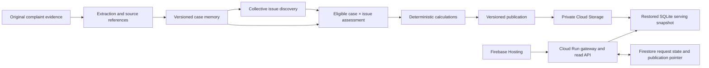

# Architecture

## Processing and serving are separate

The case investigator retrieves sources and retains grounded claims, factors, chronology, contradictions and evidence coverage. The collective investigator proposes issue definitions and assesses membership against eligible cases. Source-linked memory is more than a prose summary: supporting references and uncertainty remain available for later re-investigation.

The model interprets evidence. Deterministic engines count contributors, reconcile money and work records, and construct period aggregates. Dashboard reads do not invoke the model.

## Incremental work

The planner distinguishes new cases, changed evidence, withdrawals, interpretive resynthesis, deterministic table refreshes and unchanged cases. Unchanged memory can be reused. A new issue can require assessment of older memories, including closed complaints. Targeted retrieval revisits originals when memory does not resolve a question. A changed definition or source can invalidate affected assessments. Reuse does not mean permanently ignoring historical evidence.

Tasks use bounded requests, checkpoints, leases and resumable work. Outputs are published as a coherent version, not as a mixture of incomplete stages. Read serving and publication activation remain separate from the worker.

## Measurement rules

- Counts and shares retain explicit eligible populations and coverage.
- One complaint can support multiple issues; issue shares need not sum to 100%.
- Issue-associated cash cannot be added across overlapping issues to obtain a unique company total.
- Remedies, complaint expenses and principal/entitlement are distinct categories.
- Staff work remains hours, without an assumed salary conversion.
- Missing records mean incomplete coverage, not zero actual burden.
- Daily, weekly, monthly, quarterly and observation-year views use explicit cutoffs. Retrospective receipt-date trends do not establish that an alert existed historically.

## Code map

`ai-backend/sdbackend/intel/` owns portfolio memory, collective processing and publication; `models/` owns provider adapters; `extract/`, `intake/`, `engine/` and `store/` provide evidence and deterministic infrastructure. `cloud/` inside the Python package owns export/restore and the Vertex job entrypoint. `ui/src/` consumes published APIs. The gateway forwards requests and original-file retrieval.

Legacy Python package names (`sdbackend`, `sdgen`), environment prefixes (`SDB_`, `SD_`) and frozen schema URNs are compatibility interfaces. They are retained rather than changed cosmetically. The application and checkout are named Artha.
